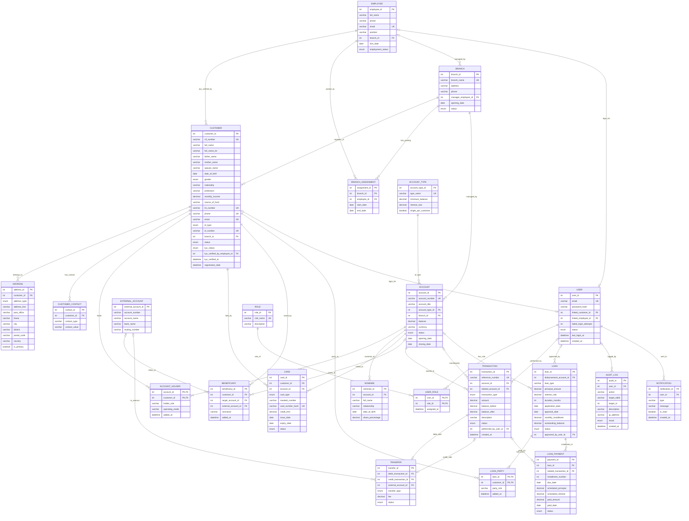

# BankEase — Banking Database Management System

> **Course:** Database Systems 2026-II
>
> **Institution:** Department of Computer Science and Engineering, Khulna University
>
> **Client Organization Studied:** BRAC Bank (Branch General Banking Operations & KYC Compliance)
>
> **Database Name:** `bankease`

## 👥 Project Team

* **Akash Kumer Dey** (`240230`)
* **Joyee Mitra Roti** (`240237`)

## 🎥 Project Presentation Video

▶️ **YouTube:** [https://youtu.be/MYuwq4_8XJg](https://youtu.be/MYuwq4_8XJg)

## 📑 Table of Contents

* [1. Project Overview](#-1-project-overview)
* [2. Project Repository Structure](#-2-project-repository-structure)
* [3. Technical Requirements](#-3-technical-requirements)
* [4. Database Installation Guide](#-4-database-installation-guide)
* [5. Database Architecture & Entity-Relationship Diagram](#-5-database-architecture--entity-relationship-diagram)
  * [Entity-Relationship Diagram (ERD)](#entity-relationship-diagram-erd)
  * [Schema Breakdown by Domain](#schema-breakdown-by-domain)
  * [Key Database Features](#key-database-features)
  * [Reporting Views](#reporting-views)
* [6. Application Configuration](#-6-application-configuration)
* [7. Running the Applications](#-7-running-the-applications)
* [8. Demo Login Credentials](#-8-demo-login-credentials)
* [9. Important Notes & Limitations](#-9-important-notes--limitations)
* [10. Included Submission Documents](#-10-included-submission-documents)

---

## 📋 1. Project Overview

**BankEase** is a comprehensive academic banking database management system paired with two web applications:

1. **Customer Site:** Provides customer-facing banking functions (account overview, fund transfers, saved beneficiaries, card details, and loan repayment tracking).
2. **Staff Portal:** Provides employee and administrator tools for managing branch operations (customer onboarding, KYC verification, account approvals, transaction processing, loan approvals, and branch reporting).

The database schema and operational workflows were designed following a requirements-determination study with **BRAC Bank**, informed by an interview with a branch General Banking Manager and analysis of a real-world *KYC Form for Beneficial Owner*.

*Disclaimer: BankEase is an academic project developed for coursework and is not an official BRAC Bank production system.*

## 📂 2. Project Repository Structure

```text
19_BankEase_FinalDB/
│
├── 19_BankEase_Report.docx             # Comprehensive project report
├── 19_BankEase_ER_Diagram.pdf          # Complete Entity-Relationship diagram
│
├── database/
│   ├── schema.sql                      # Database DDL (23 tables, constraints, indexes, 4 views)
│   └── sample_data.sql                 # Fictional demonstration DML records & consistency checks
│
└── source_code/
    ├── README.md                       # Project documentation
    │
    ├── BankEase_Customer_Site/         # Customer-facing web application
    │   ├── index.php
    │   ├── login.php
    │   ├── register.php
    │   ├── logout.php
    │   ├── config/
    │   │   ├── config.php
    │   │   └── db.php
    │   ├── includes/
    │   │   ├── auth.php
    │   │   ├── header.php
    │   │   └── footer.php
    │   ├── customer/
    │   │   └── [customer pages]
    │   └── assets/
    │       ├── css/
    │       └── js/
    │
    └── BankEase_Staff_Portal/          # Employee & Administrator portal
        ├── index.php
        ├── login.php
        ├── logout.php
        ├── config/
        │   ├── config.php
        │   └── db.php
        ├── includes/
        │   ├── helpers.php
        │   ├── loans.php
        │   ├── slip_pdf.php
        │   └── [header/footer/menu files]
        ├── dashboard/
        ├── customers/
        ├── accounts/
        ├── approvals/
        ├── transactions/
        ├── loans/
        ├── cards/
        ├── branches/
        ├── employees/
        ├── reports/
        ├── settings/
        ├── notifications/
        ├── api/
        └── assets/
            ├── css/
            └── js/
```

## ⚙️ 3. Technical Requirements

* **Database Server:** MySQL **8.0.16 or later**, or MariaDB **10.4 or later** (required for strict `CHECK` constraint enforcement and InnoDB support).
* **Web Server & Runtime:** PHP **8.x** with PDO/MySQLi enabled (compatible with XAMPP, WAMP, or LAMP).
* **Character Encoding:** `utf8mb4` collation to support Unicode characters, including customer names in **Bangla**.

## 🚀 4. Database Installation Guide

### Step 1: Start the Local Server

1. Open **XAMPP Control Panel** (or an equivalent local PHP/MySQL stack).
2. Start **Apache** and **MySQL**.
3. Open **phpMyAdmin** at `http://localhost/phpmyadmin/`, or prepare your MySQL command-line client.

### Step 2: Import the Database Schema

Import `database/schema.sql` first to create the `bankease` database, tables, constraints, indexes, and views.

> ⚠️ **Warning:** `schema.sql` starts with `DROP DATABASE IF EXISTS bankease;`. Importing it will permanently wipe and recreate any existing `bankease` database. Back up your data before running it.

* **Via phpMyAdmin:** Go to **Import**, select `database/schema.sql`, and click **Go**.
* **Via Terminal:**

  ```bash
  mysql -u root -p < database/schema.sql
  ```

### Step 3: Import the Sample Data

Once the schema import succeeds, populate the database by importing `database/sample_data.sql`.

* **Via phpMyAdmin:** Select the `bankease` database, go to **Import**, select `database/sample_data.sql`, and click **Go**.
* **Via Terminal:**

  ```bash
  mysql -u root -p bankease < database/sample_data.sql
  ```

*Note: The sample data script inserts records in foreign-key-safe order and executes two built-in consistency-check queries at the end. Both queries return **0 rows** when loaded properly.*

### Step 4: Verify Installation

Open the `bankease` database in phpMyAdmin and verify that **23 tables** and **4 reporting views** are present.

## 📊 5. Database Architecture & Entity-Relationship Diagram

### Entity-Relationship Diagram (ERD)

The interactive diagram below maps all **23 entities**, primary/foreign keys, and cardinalities across the five functional domains (you can also view the full vector diagram in [`19_BankEase_ER_Diagram.pdf`](../19_BankEase_ER_Diagram.pdf)):



### Schema Breakdown by Domain

The normalized schema comprises **23 tables** grouped across core banking domains:

| Functional Domain | Tables Included |
| :--- | :--- |
| **Organization & Staff** | `roles`, `branches`, `employees`, `branch_assignments`, `user_roles` |
| **Customer & Identity** | `customers`, `addresses`, `customer_contacts` |
| **Authentication** | `users` |
| **Accounts & Ownership** | `account_types`, `accounts`, `account_holders`, `nominees` |
| **Transactions & Transfers** | `transactions`, `transfers`, `beneficiaries`, `external_accounts` |
| **Cards** | `cards` |
| **Lending** | `loans`, `loan_parties`, `loan_payments` |
| **System & Auditing** | `notifications`, `audit_logs` |

### Key Database Features

* **Data Integrity & Constraints:** Strict Primary Keys, Foreign Keys, Unique Keys, and `CHECK` constraints (e.g., non-negative balances, valid date ranges, and mandatory verifier tracking upon KYC updates).
* **Joint Ownership & Nominees:** Supports multi-holder accounts via `account_holders` and designated beneficiaries via `nominees`.
* **Co-Borrowers & Guarantors:** Supports multiple customer roles per loan through the `loan_parties` associative table.
* **Transfer Architecture:** Pairs debit and credit transaction legs in `transfers`, supporting both internal accounts and external bank accounts (`external_accounts`).
* **Security & Traceability:** Card records store a display-safe masked number alongside a cryptographic hash (`card_number_hash`); sensitive actions are logged in `audit_logs`.
* **Performance Indexes:** Composite and single-column indexes optimize transaction histories, KYC queues, due loan installments, and unread notifications.

### Reporting Views

| View Name | Analytical Purpose |
| :--- | :--- |
| `v_daily_transaction_summary` | Completed transaction counts and totals grouped by date and branch |
| `v_account_status_summary` | Account counts and aggregate balances by branch, account type, and status |
| `v_cash_activity` | Daily cash deposit and withdrawal totals per branch |
| `v_customer_kyc_overview` | Customer KYC status, verifying staff member, verification timestamp, and branch |

## 🛠️ 6. Application Configuration

Both web applications maintain separate database configuration files:

```text
BankEase_Customer_Site/config/config.php
BankEase_Customer_Site/config/db.php

BankEase_Staff_Portal/config/config.php
BankEase_Staff_Portal/config/db.php
```

Before launching the applications:

1. Open each application's configuration files.
2. Update the host, database name (`bankease`), username, and password to match your local MySQL setup while preserving the existing variable names and connection structure.
3. Ensure both applications point to the exact same `bankease` database instance.

## 🏃 7. Running the Applications

1. Place the `BankEase_Customer_Site` and `BankEase_Staff_Portal` folders inside your web server's document root (e.g., `C:/xampp/htdocs/`).
2. Confirm that **Apache** and **MySQL** are running.
3. Open your browser and navigate to:
   * **Customer Site:** `http://localhost/BankEase_Customer_Site/`
   * **Staff Portal:** `http://localhost/BankEase_Staff_Portal/`

*(If placed inside a subfolder within `htdocs`, adjust the URLs accordingly.)*

## 🔑 8. Demo Login Credentials

The sample dataset includes pre-configured accounts for testing and evaluation.

> **Shared Demo Password:** `BankEase@2026`

### Customer Site Accounts

| Customer Name | Login Email |
| :--- | :--- |
| **Abdul Karim Mollah** | `akarim.mollah@gmail.com` |
| **Salma Khatun** | `salma.khatun92@gmail.com` |
| **Mohammad Yusuf Ali** | `yusuf.ali78@yahoo.com` |

### Staff Portal Accounts

| Staff Member | Assigned Role | Login Email |
| :--- | :--- | :--- |
| **Md. Rafiqul Islam** | Administrator | `rafiqul.islam@bankease.com.bd` |
| **Farzana Akhter** | Employee | `farzana.akhter@bankease.com.bd` |

## 📌 9. Important Notes & Limitations

* **Academic Scope:** BankEase is strictly an academic prototype built for the Database Systems course at Khulna University. Do not enter real personal data, real card numbers, or production banking credentials.
* **Fresh Imports Only:** `sample_data.sql` is intended to run once on a freshly created schema; running it multiple times without resetting `schema.sql` will trigger duplicate key errors.
* **Credential Security:** Keep local database credentials out of public repositories and shared screenshots.

## 📄 10. Included Submission Documents

* `19_BankEase_Report.docx` — Full project documentation and analysis report.
* `19_BankEase_ER_Diagram.pdf` — Entity-Relationship diagram detailing entities, attributes, cardinalities, and constraints.
* `database/schema.sql` — Data Definition Language (DDL) script.
* `database/sample_data.sql` — Data Manipulation Language (DML) script.